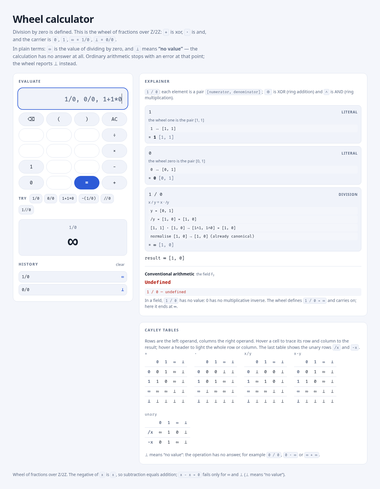

# Wheel calculator — web GUI

A fully static front end for the wheel calculator in ../../src. There is no
server and no Worker runtime: the browser evaluates expressions with the same
algebra, parser and presentation modules the CLI uses, and renders the result,
explainer and Cayley tables itself. `bun build` bundles
`gui/client/main.ts` into `app.js`; any static file server can publish
`gui/client`.

## Symbols for non-specialists

The two symbols that are not ordinary numbers are glossed in plain English
rather than left to the mathematics. Under the title the page says what `∞` and
`⊥` mean; the console hint repeats the short form; a `⊥` result gets a note
under the result card ("⊥ means 'no value' ..."); the Cayley tables carry a
note beneath the grid; and the explainer marks a final `⊥` as "no value". The
repl's `help` lists both symbols as well. `∞` is the value of `1/0`; `⊥` is
what the calculator reports when the expression has no answer at all, e.g.
`0/0`, `0 · ∞` or `∞ + ∞`. Because `⊥` absorbs, any expression containing it
ends at `⊥`.

## Keypad

The keypad uses the familiar four-column calculator grid: backspace, `(`, `)`
and `AC` on the top row, `÷ × − +` down the right column, `0` and `1` at
the bottom left, and `=` at the bottom. The wheel has only two digits and no
decimal point, so the keys for `2`–`9` and `.` are rendered blank and
disabled: they keep the grid conventional without suggesting operations the
algebra does not have. `=` submits through the local submit listener. The
top-right key reads `AC` while the display is empty and `C` once it has
content: `C` clears the display, `AC` also resets the result panel, history
and explainer. The display field stays focused, so the keyboard works alongside
the keypad for anything the grid leaves out, such as the unary `/`.

## Layout

    gui/main.ts                browser entry: keypad, evaluation, rendering, history
    gui/index.test.ts          static shell, keypad and header tests
    gui/client/index.html      page shell (static)
    gui/client/app.js          built bundle (bun run build:web)
    gui/client/styles.css      light/dark theme, Fira Code stack
    gui/client/_headers        CSP, nosniff, referrer policy, cache headers
    gui/view/render.ts         HTML fragments: result card, error, history, tables
    gui/view/explain.ts        derivation steps and conventional-field comparison
    gui/view/storage.ts        localStorage history (validated, capped)
    gui/view/*.test.ts         fragment, derivation and storage tests
    gui/screenshot.png         page screenshot used above

The GUI imports ../../src directly, so it cannot drift from the CLI: both use
the same algebra, parser and display names.

## Cayley tables

The tables are rendered in the browser from the wheel operations, never from
literals. Pointing at a row header lights that row, pointing at a column header
lights that column, and pointing at a cell lights the part of its row from the
row header through the cell plus the part of its column from the column header
down through the cell. The two arms meet at the hovered cell instead of crossing
the whole table. The classes are is-row-hot, is-col-hot and is-cell-hot, styled
in styles.css for both themes and switched off under prefers-reduced-motion. The
highlight is decoration only: without it the whole table is still readable.

## Explainer panel

Evaluating an expression also fills the explainer beside the calculator. It
walks the expression in evaluation order and shows, operation by operation, the
pair arithmetic behind it: the operands as `[numerator, denominator]`, the rule
that was applied, the raw pair (with `⊕` for XOR addition and `∧` for AND
multiplication), the normalisation step and the resulting name.

Below the steps it compares the same expression with conventional field
arithmetic (the two-element field F₂). When no division by zero occurs it shows
the operation trace and the value, and notes that the wheel agrees. When a zero
denominator is reached it shows where the field arithmetic stops, why (0 has no
multiplicative inverse), and what the wheel does instead.

## History

History lives in `localStorage` under `wheel_history`: the newest 12 results,
expressions capped at 160 characters. Stored JSON is validated on load, so
hand-edited or stale data is ignored instead of breaking the page. The clear
button in the history header resets the stored list. Because it is browser
storage, history survives reloads and is not shared between devices.

## Build and run

    bun install
    bun run build:web                                      # gui/main.ts -> gui/client/app.js
    python3 -m http.server 8787 --directory gui/client     # then open http://127.0.0.1:8787

The server serves the static directory as-is, so re-run `build:web` after
editing gui/main.ts or the view modules. The page loads no network resources beyond
its own files and the Fira Code stylesheet; everything else is computed locally.
`_headers` (honoured by static hosts that support the convention) carries the
Content-Security-Policy (self, plus Google Fonts) and the cache policy: HTML
`no-store`, JS/CSS ten minutes.

## Tests

    bun test

The page tests read `index.html` and `_headers` directly; the view tests cover
the fragments (including the plain-language ⊥ gloss), the derivation and the
localStorage history. `bun run typecheck` runs `tsgo --noEmit`.
